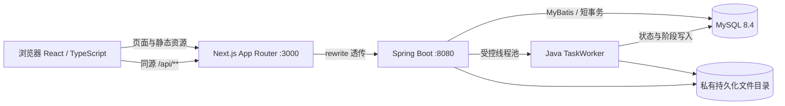
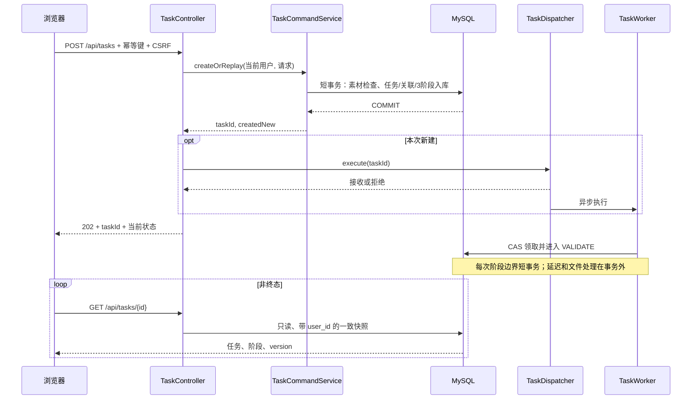

# 第 2 步：总体架构与模块设计

## 1. 系统边界



Next.js 负责页面与交互，rewrite 只转发请求；不读写 MySQL、不创建业务任务、不保存阶段状态。Java 是身份、模板、文件授权、任务执行和查询的唯一业务入口。MySQL 是任务状态事实来源；内存仅保存执行队列与会话。

本地：浏览器访问 `http://localhost:3000`，Next.js 转发到 `http://127.0.0.1:8080`。Compose：Next.js 转发到 `http://backend:8080`，Java 连接 `mysql:3306`。浏览器不使用 Docker 服务名。交付默认仅映射前端端口，后端/数据库处于内部网络。

Next.js 官方将 rewrites 定义为 URL 代理，可转发到外部地址；本项目据此选择同源入口。Cookie、错误响应、二进制和上传转发仍是 S1 的实际验证项。[Next.js rewrites](https://nextjs.org/docs/app/api-reference/config/next-config-js/rewrites)

## 2. 模块职责

| 模块 | 对外职责 | 内部组件/依赖 | 禁止承担的职责 |
|---|---|---|---|
| identity | 演示登录、退出、当前身份、CSRF | Spring Security、HttpSession、UserMapper | 接收客户端 userId 作为授权依据 |
| template | 分类与模板列表、详情、公开封面 | TemplateService / Mapper | 前端硬编码替代 Java 数据 |
| asset | 流式接收、校验、持久化、鉴权读取 | AssetService / Mapper、FileStorage | 将用户文件名用作存储路径 |
| task-command | 校验、幂等建档、提交调度 | TaskCommandService、TaskDispatcher | 等待三阶段结束再返回 |
| task-query | 个人列表、详情、结果读取 | TaskQueryService、Mapper | 推进阶段、失败补写、重新投递 |
| task-engine | 按序处理、模拟、状态转换 | TaskWorker、TaskStateService | 跨耗时处理持有数据库事务 |
| common | DTO、错误、日志、时间、配置 | 统一异常处理、Clock、ID 生成器 | 返回堆栈、真实路径或密钥 |

依赖方向为 Controller → Service → Mapper / Storage。Worker 调用独立的 `TaskStateService` 事务 Bean；避免同类方法自调用使 `@Transactional` 不生效。

## 3. 建议源码结构

下列为最初的逻辑分层建议。当前代码已实现：前端组件平铺在 components，调度为 lib/task-tracker.ts；后端 task 下以 TaskCommandService、TaskQueryService、TaskWorker、TaskStateService 等类分工，不再额外嵌套子包。事务显式使用 TransactionTemplate，保证锁定与状态交接的短事务边界。

```text
frontend/
  src/app/{templates,history,login}/
  src/components/{templates,upload,tasks,identity}/
  src/lib/{api,auth,task-polling}/
  src/types/api.ts
backend/
  src/main/java/com/example/material/
    identity/  template/  asset/  task/  common/
    task/{command,query,engine,state}/
  src/main/resources/
    mapper/  db/migration/  demo-covers/
    application.yml
  src/test/
docs/
.github/workflows/ci.yml
compose.yaml
```

前端 API 类型以 [OpenAPI](contracts/openapi.yaml) 为源，Java DTO 与其保持一致；数据库以 [schema.sql](database/schema.sql) 为初始结构输入。开发时迁移为 `V1__schema.sql`、`V2__demo_seed.sql`，后续只增加版本迁移，不反复修改已应用的迁移文件。

## 4. 创建与查询时序



`createOrReplay` 的事务必须由 Spring 代理完成后返回，再执行 `execute`。如果选用事务事件替代显式调用，只允许提交后投递；Spring 官方支持 `AFTER_COMMIT` 事务事件。本基线不混用两种调度入口。[Spring 事务事件](https://docs.spring.io/spring-framework/reference/data-access/transaction/event.html)

调度与 HTTP 回包存在竞争：202 的 `status` 可以已是 RUNNING，极短任务甚至可能已结束；前端不能假设一定先观察到 QUEUED。创建响应不要求三阶段完成，只要求已建档且没有等待 Worker。

## 5. 事务与一致性约定

| 操作 | 事务范围 | 失败处理 |
|---|---|---|
| 创建任务 | 校验 DB 归属、幂等检查、任务/3阶段/关联插入 | 任一失败全部回滚，不调度 |
| Worker 领取 | QUEUED→RUNNING 与 VALIDATE→RUNNING | CAS 0 行表示已经领取/终态，退出 |
| 阶段交接 | 当前阶段成功、下一阶段运行、当前阶段字段与 version 更新 | 一个事务提交，对外不出现半套状态 |
| 阶段失败 | 当前阶段失败、后续 SKIPPED、任务失败 | 一个事务提交，停止调用后续处理器 |
| 成功 | 文件已完成后，FINALIZE 与任务成功、result_key 写入 | DB 失败不返回成功；文件可能成为孤立文件 |
| 详情查询 | 只读 REPEATABLE READ 事务读取任务与阶段 | 无副作用，错误仅表示本次查询不可用 |

MySQL 与文件系统没有跨资源事务。采用“文件准备好 → 原子改名 → DB 成功提交”的顺序，接受异常时出现无引用文件，不能出现数据库已成功但结果尚未写完的常规路径。磁盘丢失属于存储故障，不能通过 GET 改写任务历史。

## 6. 单实例运行边界

- 线程池并发 2、等待队列 20，使用拒绝异常策略；禁止 CallerRunsPolicy，防止请求线程执行模拟延迟。
- 不在 V1 声明多实例、高可用、跨机器共享文件或任务 exactly-once 保证。
- 任务在页面关闭后继续；Java 进程停止后不继续。重启时将旧 QUEUED/RUNNING 收敛为 FAILED，见[重启处理](05-task-engine.md#7-重启与停机)。
- 会话在 Java 内存中，重启后需重新选择演示身份；个人任务和素材仍在 MySQL 与文件卷中。
- 创建提交成功到内存投递之间存在进程崩溃窗口，按重启规则处理，不宣称“可靠消息投递”。将来若要求恢复执行，再引入 DB 调度表/outbox 或消息队列。

## 7. 日志与运行指标

每条请求生成 `requestId`，后台日志关联 `taskId`、`userId`、`step`、`event`、`durationMs`、`errorCode`。记录任务受理、领取、阶段进入/退出、终态和拒绝；不记录图片内容、会话 Cookie、CSRF token、开发密钥或完整绝对路径。

开发验收至少观察：活跃 Worker 数、队列长度、任务提交/成功/失败/拒绝计数、阶段耗时、数据库可用性、剩余磁盘空间。可使用日志与受内部网络限制的 Actuator；不要求搭建监控平台。
