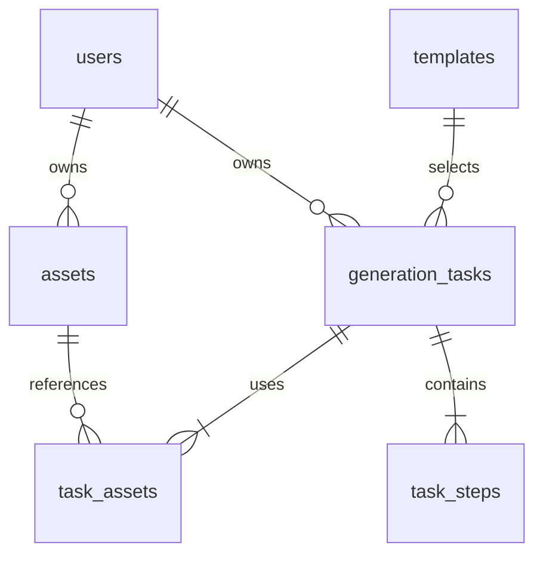

# 第 3 步：数据库与文件存储

## 1. 模型与关系



结构输入：[schema.sql](database/schema.sql)；示例记录：[seed.sql](database/seed.sql)。两份是初始设计输入，实际迁移在 backend/src/main/resources/db/；已在真实 MySQL / Testcontainers 中执行并验证约束。本项目不使用 H2 的通过结果替代 MySQL JSON、CHECK、外键、排序和事务验证。

命名：数据库 snake_case、API camelCase。业务对象 UUID 用 `CHAR(36) ascii_bin`，演示用户/模板使用可读字符串 ID；API 中不依赖 ID 连续性。所有 DATETIME(3) 按 UTC 写入，连接时区也设为 UTC；Java 通过统一 Clock 写入与序列化，不依赖操作系统本地时区。

## 2. 数据字典

### users / templates

| 表 | 字段组 | 约束与用途 |
|---|---|---|
| users | id / display_name / created_at | 两个固定身份；不保存虚构的密码哈希 |
| templates | id / title / category / description | 由 Java 查询，前端只消费 |
| templates | cover_key | Java classpath 内受控资源键，API 返回 `/api/templates/{id}/cover` |
| templates | required_image_count / accepted_mime_types / max_file_size_bytes | 1～2 图、JPEG/PNG、最多 5 MiB，模板可进一步收紧 |
| templates | active / created_at / updated_at | 无后台管理 UI；下架模板不用于新建任务，历史仍可查 |

### assets

| 字段 | 语义 | 规则 |
|---|---|---|
| id / user_id | 素材标识及所有者 | 所有者来自会话 |
| storage_key | 相对文件键 | 随机命名，不接收客户端指定 |
| mime_type / size_bytes | 实际类型与真实字节数 | 类型结合签名和解码确定，不只信请求头 |
| width / height | 解码前读取尺寸并做资源限制 | 宽高≤8192、总像素≤2500 万 |
| sha256 / created_at | 内容校验及时间 | 不作为跨用户共享或去重授权依据 |

成功保存文件后才插入素材行。没有状态为“上传中”的数据库素材；上传中只属于请求/UI。上传响应超时可能留下已经成功的素材行，前端重新上传可能得到新的 ID，这是允许的存储冗余。

### generation_tasks

| 字段组 | 用途与约束 |
|---|---|
| id / user_id / template_id | 任务标识、所有者及模板引用 |
| template_title / template_snapshot | 保存创建时模板名称、素材约束；后续模板改动不改历史 |
| client_request_id / request_hash | 用户维度幂等；同键同逻辑请求回放，同键不同请求 409 |
| simulation_json | 本次实际延迟和失败配置快照；不返回开发密钥 |
| status / current_step | 整体状态与正在/最后处理阶段；未开始即失败时阶段为空 |
| result_key / result_mime_type / result_size_bytes | 仅成功时有值；API 按任务 ID 组装鉴权 resultUrl |
| error_code / error_message | 仅任务失败时有值；用户可读，禁止服务器路径/堆栈 |
| version | 每次可见状态变更递增，用于前端拒绝较旧响应 |
| created_at / updated_at / started_at / finished_at | UTC 毫秒精度；排队无 started_at，非终态无 finished_at |

`template_snapshot` 示例：`{"requiredImageCount":2,"acceptedMimeTypes":["image/jpeg","image/png"],"maxFileSizeBytes":5242880}`。`simulation_json` 示例：`{"failAtStep":null,"delaysMs":{"validate":1000,"generate":5000,"finalize":1000}}`。

`request_hash` 基于规范化的 `templateId + 有序 assetIds + 请求中显式 simulation 或 null` 计算 SHA-256；不包括幂等键、Cookie 和开发密钥，也不包括随后可能变化的环境默认值。已存在同键任务优先返回原快照，不再次读取当前默认值重新调度。

### task_assets / task_steps

| 表 | 字段组 | 规则 |
|---|---|---|
| task_assets | task_id / user_id / asset_id / position | position 从 1 开始，保持上传槽位顺序；同任务不重复引用同一素材 |
| task_steps | task_id / step_name / step_order | 恰好 VALIDATE(1)、GENERATE(2)、FINALIZE(3) |
| task_steps | status / started_at / finished_at | PENDING/SKIPPED 无执行时间；RUNNING 只有开始；执行终态两者均有 |
| task_steps | error_code / error_message | 仅 FAILED 有错误，SKIPPED 不伪造失败原因 |

关联表中的 user_id 是刻意冗余：两个复合外键保证任务和素材属于同一用户。应用仍必须做权限检查，数据库约束属于第二层保护。外键默认限制删除，V1 无删除历史与物理删除素材接口。

## 3. 约束、索引与查询

- `uk_task_request(user_id, client_request_id)`：防止重试产生重复任务。并发插入触发唯一冲突时，回滚当前事务，再在独立查询中读取已有记录。
- `idx_task_user_created`：个人历史按 `created_at DESC, id DESC` 稳定分页。
- `idx_task_user_status_created`：查个人未完成任务或指定终态。
- `idx_task_template_created`：制作页按模板查询当前用户历史。
- 任务和阶段的状态、时间、结果和错误组合由 CHECK 约束保护；“恰好三阶段”“阶段互斥”“模板图数等于关联数”等跨行约束由事务服务及测试保证。
- 自增 version 使用数据库 `version = version + 1`，每次状态修改也显式更新 updated_at。

典型历史查询（参数均绑定，不能拼接用户输入）：

```sql
SELECT id, template_id, template_title, status, current_step, version,
       created_at, updated_at, started_at, finished_at,
       result_key, error_code, error_message
FROM generation_tasks
WHERE user_id = :currentUserId
  AND (created_at < :cursorCreatedAt
       OR (created_at = :cursorCreatedAt AND id < :cursorId))
ORDER BY created_at DESC, id DESC
LIMIT :limitPlusOne;
```

首页不带游标条件；可选模板/状态过滤通过 MyBatis `<if>` 加入。游标为 `{createdAt,id}` 的不透明 base64url 编码，解析时检查格式/长度，不作为身份凭证。每页 limit 默认 20、最大 100，多查一行判断 nextCursor。切换筛选条件重置游标。

任务详情在只读 REPEATABLE READ 事务中先查带 user_id 的任务，再按 step_order 查阶段，避免一个响应混入不同边界版本。返回的 version 对应该事务的任务快照。

## 4. 文件布局与权限

```text
STORAGE_ROOT=/data/material
  uploads/{userId}/{assetUuid}.jpg|png
  results/{userId}/{taskUuid}.jpg|png
  tmp/{randomUuid}.part
```

目录只对 Java 服务开放，不作为 Next.js public 目录，不通过静态服务器暴露。封面属于公开演示资源，单独从 classpath 读取。素材/结果读取先使用会话查询归属，再通过服务端保存的相对键定位文件。

路径校验：`root.resolve(key).normalize()` 必须位于 root 内；目录拒绝符号链接逃逸，文件以普通文件方式打开。客户端文件名、URL、扩展名不参与路径拼接，日志也不输出原始绝对路径。

## 5. 上传与结果写入协议

上传顺序：

1. 检查登录、CSRF、multipart 数量，只接受一个 `file` 部件；请求上限 6 MiB，单文件上限 5 MiB。
2. 流式写入随机 `.part` 文件，累计真实大小，超限立即结束并清理；不一次读入大字节数组。
3. 识别 JPEG/PNG 签名，读取尺寸并检查上限，然后实际解码确认图片有效。拒绝 SVG、GIF、WebP、损坏图片及伪造 MIME。
4. 根据实际类型确定扩展名、计算 SHA-256，在同一文件卷内原子移动至 uploads。
5. 短事务插入 assets，提交后返回 201。DB 失败时尽力移除本次文件；失败未清理的文件视为孤立文件。

模板数量、素材归属、重复 ID、每个素材是否符合模板约束在创建任务时再次检查；执行 VALIDATE 时再次确认文件存在且可读取，避免“上传成功后文件丢失”被当成成功。

结果顺序：GENERATE 在 tmp 中准备第一张输入的副本；FINALIZE 校验副本并原子移动到 results，确认可读、字节数与 MIME，再提交任务成功事务。任务成功与最后阶段成功必须一起提交。API 仅在任务为 SUCCEEDED 时读取 result_key。

`.part` 与正式文件必须在同一 volume，避免跨文件系统移动失去原子性。数据库提交失败、进程被杀可能留下孤立文件；V1 不自动垃圾回收。UI 移除/替换只取消槽位关联，已存素材不删除，已提交任务所引用的文件不会被 UI 操作影响。

## 6. 读取与故障边界

素材和结果响应：正确的 `Content-Type`、`Content-Length`、`X-Content-Type-Options: nosniff`、`Content-Disposition: inline`，并设置 `Cache-Control: private, no-store`。不依赖带 token 的公开链接；浏览器同源图片请求自动携带会话 Cookie。

- 他人/不存在素材或任务：统一 404，避免枚举对象存在性。
- 非成功任务请求结果：409 `RESULT_NOT_READY`。
- 已成功记录的结果文件丢失：503 `RESULT_UNAVAILABLE`，保留数据库成功历史并提示存储故障；GET 不改变任务状态。
- 磁盘满/写入失败：上传返回 503，运行任务在对应阶段失败；数据库也不可用时记录结构化日志，重启收敛残余状态。

容器将 `/data/material` 挂载独立持久化卷；MySQL 使用自己的卷。V1 文件累计增长，应在演示前检查空间，停机备份后才能人工清理；不宣称有配额、自动过期或在线清理能力。
