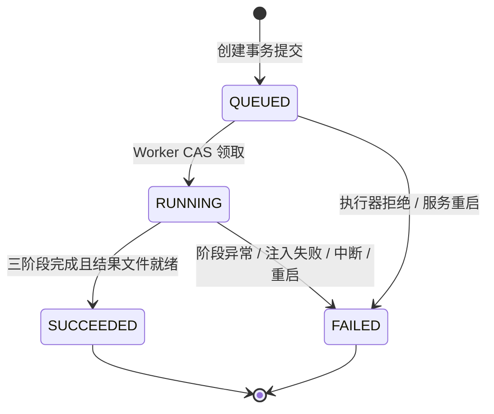

# 第 5 步：异步任务与状态机

## 1. 状态定义与不变量



阶段固定为 VALIDATE → GENERATE → FINALIZE。阶段转换为 `PENDING→RUNNING→SUCCEEDED/FAILED`，前序失败的 PENDING 变为 SKIPPED。终态不再修改，不自动重试，也不提供重新执行同一任务接口。

必须始终成立：

1. 一个任务最多一个 RUNNING 阶段；三个阶段创建时一次性入库。
2. RUNNING 任务必有一个 RUNNING 阶段，currentStep 与之相同；阶段交接用一个事务完成。
3. SUCCEEDED 任务三阶段均成功，有结果键/类型/大小和 finishedAt，无错误。
4. 阶段失败时任务同时失败，后续阶段均 SKIPPED 且没有开始/结束时间。
5. 执行前拒绝/重启的任务可以没有失败阶段：currentStep=null，三个阶段均 SKIPPED，任务错误解释原因。
6. 所有状态变化在 MySQL 提交后才可被查询观察，GET 无任何推进副作用。

## 2. 创建、提交与幂等

控制器顺序（行为伪代码，不是已实现源码）：

```text
验证会话、CSRF、请求结构、开发覆盖权限
record = commandService.createOrReplay(userId, key, request)
  // 独立事务已提交；素材校验/关联/三阶段/模拟快照全部就绪
if record.createdNew:
    try dispatcher.execute(record.taskId)
    catch RejectedExecutionException:
        stateService.rejectBeforeStart(record.taskId)
读取当前状态（可能已经开始执行）
返回 202 + taskId + status + replayed
```

`createOrReplay` 先按当前用户/幂等键查已存在任务：规范化请求哈希相同直接回放，不重复校验已下架模板或重新调度；不同则 409。新建时先验模板、素材归属和模板约束，再写任务、关联与三个 PENDING 阶段。唯一键并发冲突须回滚后重新读取，不在已失败事务中继续查询。

请求线程只做必要校验、短事务和投递，不执行 sleep、不等待 Future.get / join。线程池配置：core=max=2、队列 20、AbortPolicy。输入仅 taskId，Worker 自行从 DB 加载快照，不捕获 ServletRequest、MultipartFile、浏览器连接或请求线程的认证上下文。

拒绝已入库任务时，在独立短事务将 QUEUED→FAILED，errorCode=EXECUTOR_REJECTED，所有 PENDING→SKIPPED，version+1。正常返回该失败任务 ID，便于在历史中解释。若拒绝落库也失败，停止本次执行并返回 SUBMISSION_UNCERTAIN，客户端以原幂等键确认。

## 3. 执行算法

```text
if !stateService.claimAndStartValidate(taskId): return
try:
    validate(task snapshot, files)           // 无数据库长事务
    stateService.succeedAndStartNext(VALIDATE, GENERATE)
    generate(task snapshot, temp copy)       // 无数据库长事务
    stateService.succeedAndStartNext(GENERATE, FINALIZE)
    result = finalize(temp copy, storage)    // 文件完整、原子移动、可读性检查
    stateService.completeWithResult(result)
catch StageException e:
    stateService.failCurrentAndSkipRemaining(e)
    return
catch InterruptedException e:
    恢复中断标志；尽力持久化 EXECUTION_INTERRUPTED；退出
catch unexpected:
    尽力持久化 STEP_EXECUTION_FAILED；记录 request/task 关联日志；退出
finally:
    尽力清理本任务临时文件
```

每次状态写入都先锁定该任务行（SELECT FOR UPDATE）并验证预期任务/阶段状态，再进行关联更新；所有方法使用同一加锁顺序“任务→阶段”。领取也可用条件 UPDATE 完成 CAS：

```sql
UPDATE generation_tasks
SET status = 'RUNNING', current_step = 'VALIDATE', started_at = :now,
    updated_at = :now, version = version + 1
WHERE id = :taskId AND status = 'QUEUED';
```

领取事务内同步把 VALIDATE 置为 RUNNING，任何一个更新不满足预期则回滚。CAS 0 行直接退出，不重复调用处理器。不能把“任务领取成功”与“阶段运行”拆成两个提交。

边界写入失败时，不继续下一个处理器。对业务异常只提交一次一致的失败状态；如果数据库持续不可用，Worker 停止并输出结构化错误，任务可能暂留 RUNNING，直到单实例重启收敛。V1 不以“总能立即写入失败”掩盖数据库故障。

## 4. 阶段输入输出与边界事务

| 阶段 | 事务外工作 | 边界成功事务 |
|---|---|---|
| VALIDATE | 从创建快照检查数量、所有者关联、类型大小，确认文件存在/可读；执行配置延迟与注入 | VALIDATE=SUCCEEDED、GENERATE=RUNNING、currentStep=GENERATE、version+1 |
| GENERATE | 执行配置延迟与注入；复制 position=1 图片到本任务 tmp 文件 | GENERATE=SUCCEEDED、FINALIZE=RUNNING、currentStep=FINALIZE、version+1 |
| FINALIZE | 执行配置延迟与注入；确认 tmp 正确，原子移动到 results 并检查可读 | FINALIZE=SUCCEEDED、任务=SUCCEEDED、结果信息/finishedAt、version+1 |

进入每阶段先记录 RUNNING，再进行延迟；因此设置足够长延迟时 API 可稳定观察阶段。失败注入在延迟之后、阶段成果发布之前触发，三个阶段均可独立指定。VALIDATE 的真实文件损坏等错误仍可提前失败。

阶段交接使用同一个 `now` 作为前阶段 finishedAt 与后阶段 startedAt；外部快照只出现合法组合。固定 Clock 与可替换 Sleeper 用于测试，不在单元测试里真实等待数十秒。

完整成功状态轨迹：

| version | 任务状态 | currentStep | VALIDATE | GENERATE | FINALIZE |
|---|---|---|---|---|---|
| 0 | QUEUED | null | PENDING | PENDING | PENDING |
| 1 | RUNNING | VALIDATE | RUNNING | PENDING | PENDING |
| 2 | RUNNING | GENERATE | SUCCEEDED | RUNNING | PENDING |
| 3 | RUNNING | FINALIZE | SUCCEEDED | SUCCEEDED | RUNNING |
| 4 | SUCCEEDED | FINALIZE | SUCCEEDED | SUCCEEDED | SUCCEEDED |

第二阶段失败轨迹到 version=2 后，进入 version=3：任务 FAILED、currentStep=GENERATE、VALIDATE=SUCCEEDED、GENERATE=FAILED、FINALIZE=SKIPPED。失败事务的三项更新必须一并提交。

## 5. 文件与数据库的失败组合

| 故障点 | 已有记录 | 行为 |
|---|---|---|
| 创建事务失败 | 无完整任务 | 不投递，返回请求错误 |
| 提交后/投递前进程死亡 | QUEUED | 重启收敛 SERVER_RESTARTED，不自动重放 |
| 模拟生成异常 | 当前阶段运行中 | 失败事务 + 跳过后续，无 resultUrl |
| 最终文件移动失败 | FINALIZE 运行中 | FINALIZE 与任务失败，尽力清 tmp |
| 文件就绪后成功事务失败 | 结果文件可能存在，任务非成功 | 不返回成功；停止，记录故障，可能留孤立文件 |
| DB 提交结果不确定 | 可能已成功，也可能未提交 | 重新连接读取任务确认；不得无条件删除正式文件或覆盖终态 |
| 成功后磁盘故障 | DB 仍为 SUCCEEDED | 结果 GET 返回存储错误；GET 不改历史 |

正常处理失败时清理临时文件。只有确认成功事务未提交且没有任务引用时，才允许尽力清理正式结果；提交结果不确定时保留，避免删除已成功结果。

## 6. 模拟控制

| 配置 | 默认 | 范围 |
|---|---|---|
| SIM_VALIDATE_DELAY_MS | 1000 | 0～30000 整数 |
| SIM_GENERATE_DELAY_MS | 5000 | 0～30000 整数 |
| SIM_FINALIZE_DELAY_MS | 1000 | 0～30000 整数 |
| SIM_FAIL_AT_STEP | NONE | NONE / VALIDATE / GENERATE / FINALIZE |
| DEMO_SIMULATION_OVERRIDE_ENABLED | false | 只在本地演示按需开启 |
| DEMO_CONTROL_KEY | 无默认可用密钥 | 开启覆盖时必须设置非空、本地保管值 |

默认参数启动时校验，不合法则拒绝启动；单任务覆盖校验失败则拒绝请求。`NONE` 在持久化/API 中转换为 null。创建时解析完整快照写入 simulation_json；环境变化不改变已受理任务。

优先使用带密钥的单任务覆盖演示成功/指定失败并存。也可在全部任务结束后修改环境、重启 Java，再重新登录和创建任务；不能以修改全局变量影响其他用户正在执行的任务。

## 7. 重启与停机

V1 只允许一个 Java 实例。启动顺序是：数据库迁移 → 扫描旧非终态记录并收敛 → 启用线程池和就绪探针 → 接受请求。扫描按任务短事务分批执行，失败则保持未就绪，不能先接收新任务再把新任务误标为旧任务。

- 旧 QUEUED：任务 FAILED / SERVER_RESTARTED，currentStep=null、startedAt=null，三阶段 SKIPPED。
- 旧 RUNNING：保留已成功阶段；运行阶段 FAILED / SERVER_RESTARTED；后续 PENDING→SKIPPED；保留 currentStep。
- 已终态任务：不变，结果文件保留。
- 不继续原任务、不重置为 QUEUED、不自动重试。用户若需要演示成功可重新创建另一项任务。

优雅停机先停止接收新请求，再给执行器最多 30 秒结束；超时中断，不继续调度后续阶段。Compose 为 Java 留出 40 秒停止宽限。极端强制退出产生的非终态在下次启动处理。内存队列不持久化，任务记录持久化。

多实例会使上述“启动时收敛所有旧任务”的前提不成立，未来扩展须引入执行租约/心跳与共享存储；不能只增加 backend replicas。

## 8. 核心验收证据

利用可控制延迟在每个边界读取 GET 详情，并查询 task_steps 和 generation_tasks，核对 version、时间及合法组合。自动化测试还需用可阻塞处理器确认创建请求先返回，用 spy 确认失败后的处理器从未被调用。仅凭最终页面截图或日志无法证明顺序、事务与异步解耦。
