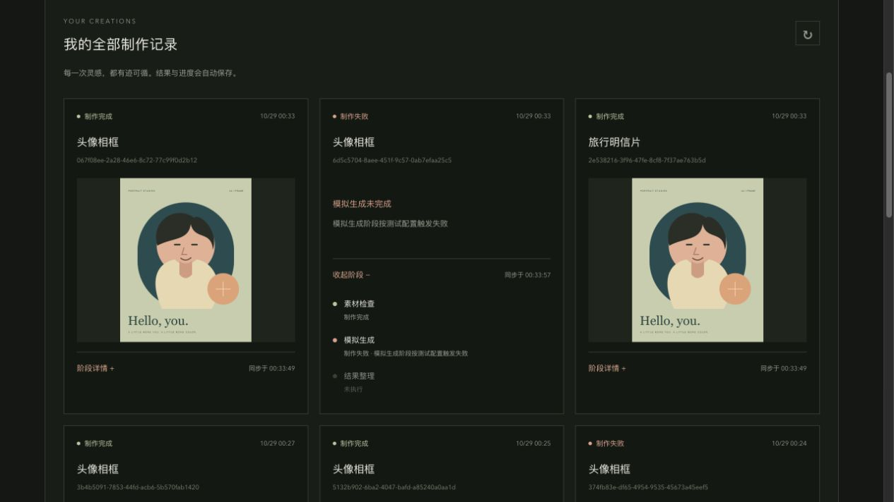

# V1.0 实施与验收记录

日期：2026-10-29，Asia/Shanghai。对应用户补充的原题 R-01～R-14、PRD V1.0 和 [TODO](../TODO.md)。本页保留业务闭环完成时的验证快照；后续界面、账户入口与记录筛选以[布局迭代记录](12-layout-and-personal-records.md)为准。原始 PRD 保持原字节，不把附件里的交付指示视为向外发送材料的授权。

本轮完成身份、上传、任务受理、Java 三阶段异步处理、可控失败、只读查询、个人历史、结果预览和前端多任务生命周期。GitHub 仓库为私有；交付消息提供验收 commit、对应 CI 链接与本地源码包，未自动邀请外部评审。

## 1. 实现与设计的对应

| 模块 | 主要实现 |
|---|---|
| 身份 | AuthController、SecurityConfig；两个演示身份、会话 ID/CSRF 轮换、注销、同源 Origin 检查 |
| 上传 | AssetService、FileStorage；真实 PNG/JPEG 校验、尺寸/大小限制、UUID 存储键、归属读取 |
| 受理 | TaskCommandService；短事务创建任务/阶段/输入关联、用户级幂等唯一键，提交后投递 |
| 执行 | TaskWorker、TaskProcessor、TaskStateService；阶段耗时在事务外，交接原子提交，终态保护 |
| 调度 | TaskRuntime、TaskDispatcher；2 线程/20 队列默认值，拒绝明确失败，单实例启动收敛 |
| 查询 | TaskQueryService；个人游标历史、一致详情快照、鉴权结果；GET 不改变业务状态 |
| 前端 | AuthProvider、CreationForm、TaskTracker、TaskHistory；按身份/epoch/taskId 隔离，版本合并与取消旧请求 |
| 交付 | 三服务 Compose、数据库/文件卷、锁定依赖、GitHub Actions、OpenAPI 生成类型 |

当前前端组件平铺在 components，调度器为 lib/task-tracker.ts；后端类在 task 包按职责命名，事务显式使用 TransactionTemplate。未照搬早期建议的每个子目录名称。`/login` 只选择身份，再通过导航进入制作或历史，不接受 redirect 参数。错误类型保留 requestId，界面未单独制作诊断展开面板。

OpenAPI 14 项操作已实现。源码中的实际入口、配置和运行命令见[README](../README.md)。本轮没有修改已应用的数据库迁移。

## 2. 实际执行的检查

| 检查 | 结果 |
|---|---|
| 前端 lint / TypeScript | 通过 |
| 前端 Vitest | 5 个文件、18 项通过，无跳过 |
| Next.js 生产构建 | 通过，Compose 使用 standalone 运行 |
| Java Maven verify | 19 项通过：3 单元、16 MySQL 集成；jar 构建通过 |
| OpenAPI | 结构校验通过；生成 TS 类型无漂移 |
| Compose | 三服务构建与健康检查通过，浏览器入口 3001 |
| 全栈 smoke | 三任务混合成功/失败、上传、幂等、用户隔离、只读查询、刷新历史、图片字节全部通过 |
| 重启/重建 | 保留卷后重建 backend/frontend，历史、上传图和成功结果仍可读取 |
| 浏览器 | 桌面上传/提交/刷新/历史/切换身份，320px 键盘上传/移除/提交与布局检查通过 |

后端 verify 使用独立临时 MySQL Testcontainers 和临时文件目录，不依赖开发库。三个阶段分别通过闩锁暂停，HTTP 创建已先返回，另一查询能看到已提交的阶段边界；释放闩锁后再推进。三个指定失败位置均断言后续处理器未调用。额外验证注销不取消后台任务、并发同键只执行一次、队列拒绝、重启收敛和结果文件丢失不改成功状态。

前端测试验证多任务乱序、版本回退保护、终态停查、查询异常保留原状态、同任务不重叠/全局最多 4 并发、ACTIVE 翻页恢复历史首页之外的任务、隐藏/恢复与迟到响应、上传替换、提交结果不确定时保持原键、身份切换和跨标签失效。不是逐行镜像实现的快照测试。

CI 在 push / pull_request 自动重复执行前端 lint/类型/测试/构建、Java 测试/构建，并校验生成类型。验收 commit 及与之匹配的运行链接见交付消息；也可在[Actions](https://github.com/Zyw-mmj/material-studio/actions)按当前提交核对，不以 v0.1 的旧运行替代本轮结果。

## 3. 可审阅的全栈证据

- [三任务 smoke JSON](evidence/smoke-evidence.json)：提交耗时约 15～30ms；正常任务观察到 VALIDATE、GENERATE、FINALIZE；指定 GENERATE 失败任务止于该阶段。
- [重启/重建 JSON](evidence/restart-evidence.json)：强制中断未完成任务，启动后 FAILED / SERVER_RESTARTED，阶段为 FAILED、SKIPPED、SKIPPED；旧成功结果和输入仍可读取。
- [数据库阶段快照](evidence/task-stage-snapshot.tsv)：查询链路中断期间 Java 仍顺序完成，最终 SUCCEEDED / FINALIZE，三个实际时间区间已落库。
- [查询中断界面](evidence/query-interruption.png)：只停止前端代理，保留 Java/MySQL 运行；页面仍显示“正在制作 / 模拟生成”，同时显示“状态暂时无法更新”。恢复代理后点击重新查询，同一 taskId 显示成功结果。
- [个人历史界面](evidence/history-desktop.png)：成功图片、独立任务 ID 和失败原因。

这些证据仅含演示用户和项目自制图片，没有 Cookie、CSRF token、开发密钥或私人素材。运行时数据和原始日志保留在本机忽略目录，不打包进源码交付。

## 4. AT-01～AT-14 对照

| 用例 | 本轮证据与结论 |
|---|---|
| AT-01 模板 | Java 集成验证分类/详情/封面/空分类，浏览器读取真实模板；通过 |
| AT-02 数量 | 后端少图/多图/重复 ID 拒绝且无半条任务，前端全部槽位 ready 才可提交；通过 |
| AT-03 上传 | 有效 JPEG/PNG、声明不符、坏图、尺寸/像素/大小限制与私有文件读取集成测试；通过 |
| AT-04 异步 | 闩锁阻塞阶段时 POST 已返回；注销后 Worker 继续并可新会话读取结果；通过 |
| AT-05 阶段 | 三阶段独立闩锁和已提交快照，完整成功结果；通过 |
| AT-06 失败 | 三个位置稳定注入失败，前序成功/当前失败/后序跳过，后续处理器零调用；通过 |
| AT-07 落库 | API/DB 时间与版本一致，查询只读，浏览器刷新恢复；通过 |
| AT-08 查询异常 | 真实代理中断界面 + 前端异常测试；业务状态保留，恢复查询成功；通过 |
| AT-09 多任务 | 三任务混合成功/失败的真实 smoke，前端乱序独立更新测试；通过 |
| AT-10 停查 | fake timers 推进超过轮询周期，SUCCEEDED/FAILED 不再自动请求；通过 |
| AT-11 切页/刷新 | 浏览器提交后刷新、历史导航；ACTIVE 多页恢复与取消旧响应测试；通过 |
| AT-12 身份 | 两套独立 Cookie 会话读取对方素材/任务/结果 404；界面切 B 立即为空；通过 |
| AT-13 结果 | 同源鉴权 PNG 与输入字节一致，重建后可读；跨用户拒绝；通过 |
| AT-14 复现 | Compose 全流程、真实干净测试库迁移、依赖锁定及 CI；通过，运行状态按验收提交核对 |

R-11 补充检查：在 320×760 视口中用键盘 Enter 选择身份、触发文件选择、移除素材、提交，再通过导航进入历史；桌面也完成上传/提交。小屏读取 documentElement 的 clientWidth/scrollWidth 均为 305（含浏览器滚动条占位后），没有页面横向溢出。测试后已恢复默认视口。未声称对所有设备、浏览器或屏幕阅读器完成兼容认证。

## 5. 已知边界与未执行的扩展验证

原题必需业务均完成。以下仍是明确边界：

- 固定演示身份无密码，可自由切换，不能用于真实身份认证或私密生产数据。
- 模拟结果复制第一张图；无真实 AI、视频、支付、积分、复杂模板后台或第三方账号。
- 单 Java 实例、有界内存队列；进程重启将未完成任务收敛失败，不续跑、不自动重试。强制停机与保留卷重建已实测。
- 文件与 DB 无跨资源事务；允许异常孤立文件，没有自动容量清理。未逐一注入磁盘满、原子移动故障、DB 提交结果不确定等所有极端故障；已测试结果文件丢失与成功状态分离。
- 未额外编写创建事务中途数据库插入失败的故障注入用例，也未对所有并发交接组合做压力测试；已测试创建校验无半条任务、并发幂等和各阶段事务边界。
- 没有原任务重新执行、下载/删除 API；UI 移除只移除上传槽。上传草稿和未确认提交不跨页面刷新保存，已受理任务从历史恢复。
- README 给出基本备份/回滚步骤，未演练生产备份恢复、公网部署或多实例运行；原题不要求这些能力。

早期设计文档的测试表是覆盖方向，不能把本节未执行的极端故障注入误记为已验证。原题范围外内容也不列为待完成必需功能。

## 6. 实际投入与交付核对

早期文档和工程初始化阶段未单独计时。本轮 goal 开发于 2026-10-28 23:35（Asia/Shanghai）开始；截至 2026-10-29 00:31，本轮约 56 分钟墙钟时间，包含编码、测试、构建与工具等待，不等于人工纯编码工时。后续 CI 等待及打包时间以 Git/Actions 时间戳为准，不回填估算的早期投入。

源码交付按最终 Git commit 打包，排除 node_modules、target、.next、真实 .env、运行卷和私人素材。GitHub 私有仓库权限保持原状，本地源码包可用于交付评审。AI 使用与自制素材/脚手架复用范围详见 README。
