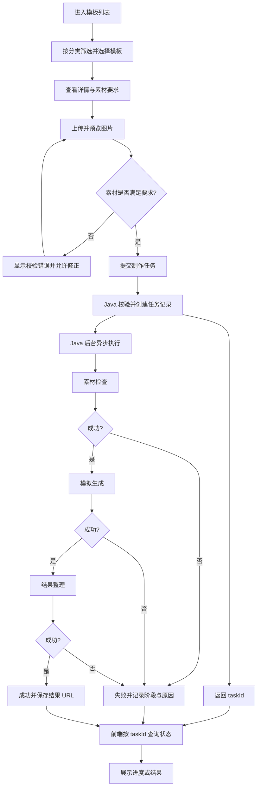

# 素材制作平台（模拟生成）产品需求文档 PRD

> **项目来源**：小影科技 2027 校招—全栈开发笔试题  
> **文档版本**：V1.0  
> **整理日期**：2026-10-28  
> **文档状态**：开发基线（基于题目截图整理；建议性设计须与原题要求区分）  
> **适用对象**：前端、Java 后端、测试、评审与验收人员

## 0. 文档说明

### 0.1 需求来源与优先级

本 PRD 依据题目截图中 **R-01～R-14** 的要求整理，保留其约束与验收重点。为使需求能够直接落地，补充了业务对象、页面状态、接口草案、数据模型建议和测试场景。

需求标记：

- **【必需】**：题目明确要求的能力或限制，必须满足。
- **【建议】**：为实现必需目标而提出的可替换设计，不是题目强制指定的唯一做法。
- **【范围外】**：原题明确不要求，不能因未实现而认定本题不合格。

如本文建议与题目原始说明冲突，以原始说明为准。

### 0.2 文档使用边界

本产品是**可独立运行、可验证的模拟素材制作网站**，不是实际接入 AI 推理能力的商业产品。它要求形成完整的“浏览模板 → 上传素材 → 提交任务 → Java 后台多步骤异步执行 → 状态可观测 → 历史结果查看”闭环。

---

## 1. 产品概述

### 1.1 产品定位

用户从素材制作平台中选择一个模板，按模板要求上传图片，创建素材制作任务。后台使用可控耗时、可指定失败阶段的模拟处理器，按既定步骤处理任务，并将阶段和结果持续写入 MySQL。用户可以离开制作页面、刷新浏览器，再进入页面查看任务进度和历史记录。

### 1.2 产品目标

| 编号 | 产品目标 | 成功判定 |
|---|---|---|
| G-01 | 模板可发现 | 用户可在页面中浏览、筛选来自 Java 接口的模板 |
| G-02 | 素材可提交 | 上传数量、类型、大小等校验正确，素材在服务端可访问 |
| G-03 | 任务可异步运行 | 提交接口返回任务 ID，而非等待全部步骤执行完 |
| G-04 | 进度可观察 | 三个后台阶段的状态、任务整体状态及失败原因可查询 |
| G-05 | 失败可验证 | 可主动使指定阶段失败，后续阶段不继续执行 |
| G-06 | 多任务不串扰 | 多个任务独立创建、执行、查询、展示 |
| G-07 | 记录可恢复 | 刷新页面后，从 Java/MySQL 恢复历史和未完成任务 |
| G-08 | 工程可复现 | 提供源代码、测试、CI、初始化数据和启动说明 |

### 1.3 用户角色

| 角色 | 权限 | 备注 |
|---|---|---|
| 普通用户 | 查看模板、上传素材、提交任务、查询自己的任务和结果 | **【必需】**；可以采用演示身份方案 |
| 开发/评审人员 | 调整模拟耗时和指定失败阶段、运行测试、验证服务 | **【必需】**提供可重复的模拟控制；不要求单独制作管理后台 |

### 1.4 主要用户故事

1. 作为用户，我想浏览不同分类的模板，以选择适合的制作效果。
2. 作为用户，我想查看模板需要上传几张图片、允许的格式和大小，以避免无效提交。
3. 作为用户，我想在上传时预览、替换或删除素材，以确保提交的是正确图片。
4. 作为用户，我想提交后立即收到任务 ID，并继续使用网站，而不是一直等待请求完成。
5. 作为用户，我想看到任务处于排队、执行、成功或失败状态，以及当前处理阶段。
6. 作为用户，我想同时发起多项制作任务，并单独查看每一项状态和结果。
7. 作为用户，我想刷新或重新进入页面后恢复任务记录，而不是丢失进度。
8. 作为评审人员，我想设置失败阶段或耗时，以验证失败中断、异步执行及多任务隔离。

---

## 2. 需求范围

### 2.1 本次交付范围（In Scope）

- 模板列表、分类筛选、模板详情展示。
- 素材上传、预览、替换、删除及前后端校验。
- 创建模拟制作任务、服务端持久化、Java 后台异步处理。
- 三阶段处理：**素材检查 → 模拟生成 → 结果整理**。
- 阶段耗时可配置、指定阶段可稳定复现失败。
- 任务整体状态、阶段状态、错误信息和结果地址查询。
- 多任务并行或排队运行，前端独立展示并维护各自的状态查询。
- 个人历史任务、页面刷新后恢复、成功结果预览。
- 用户身份及个人记录隔离方案。
- 页面基本可用性、错误反馈和桌面端主要布局。
- GitHub Actions CI、核心测试、源码/初始化数据/README 交付；建议容器一键启动。

### 2.2 明确不在范围内（Out of Scope）

- 真实 AI、真实生成模型或付费 AI 接口。
- 支付服务、积分与会员系统。
- 复杂模板管理后台、复杂素材编辑器、真实视频处理。
- 第三方账户接入与国际化。
- 多区域部署、集群与消息队列运维。
- 服务重启后未完成任务自动恢复执行。
- 失败任务自动重试、用户重新执行失败任务。
- 精准百分比进度、固定接口路径或特定状态枚举名称。
- 移动端单独设计一整套页面、自动化线上生产部署。

### 2.3 方案假设

- **【建议】**使用两到三个示例模板；至少要能演示分类切换和不同素材数量要求。
- **【建议】**模拟生成的成功结果可为上传图片的副本、预置的示例图片或经过简单本地处理得到的图片；不要求真正的 AI 推理。
- **【建议】**使用本地文件系统持久化上传文件及输出结果，并在容器中挂载持久化目录。
- **【建议】**使用演示用户身份（例如两个固定用户 + 会话标识），同时在 Java 端实现记录所有权检查。
- **【建议】**通过轮询实现状态更新，避免额外搭建 WebSocket/SSE；原题允许上述任意合理方式。

---

## 3. 技术和工程约束（R-01）

| 层次 | **【必需】**技术选型/约束 | 说明 |
|---|---|---|
| 前端 | Next.js App Router、React、TypeScript | Next.js 可直接调用 Java API，也可提供接口中间层 |
| 后端 | Java、Spring Boot、MyBatis | 业务执行与持久化不能只在 Next.js 中完成 |
| 数据库 | MySQL | 模板/任务/个人记录相关信息由 Java 服务提供；任务状态与历史记录持久化 |
| 基础设施 | 自行选择兼容版本 | 必须在 README 中声明版本、构建和启动方法 |
| 任务执行 | Java 后台异步执行 | 不强制采用 Redis、MQ、SSE、WebSocket |
| 结果文件 | 本地持久化目录或其他合法可用资源 | 不能仅以浏览器临时 URL 代替服务端可访问素材 |

**【建议】实现方式**：一个 Next.js 前端、一个 Spring Boot 单体服务、一个 MySQL 实例、一个文件持久化目录；Java 使用受控线程池运行后台任务，前端用 HTTP 轮询获取状态。

---

## 4. 关键业务流程

### 4.1 核心流程



### 4.2 任务生命周期

- `QUEUED`：创建成功，尚未开始后台处理。
- `RUNNING`：至少一个阶段正在执行，未到终态。
- `SUCCEEDED`：全部阶段成功，结果地址已持久化。
- `FAILED`：某阶段执行失败，原因已持久化，后续步骤不再执行。

**【建议】合法转换**：`QUEUED → RUNNING → SUCCEEDED / FAILED`；提交执行被拒绝时可将已创建的任务标为 `FAILED`，并记录拒绝原因。终态不再因查询请求改变。

### 4.3 阶段生命周期

- `PENDING`：尚未开始。
- `RUNNING`：正在执行。
- `SUCCEEDED`：阶段执行完成。
- `FAILED`：阶段失败，记录原因。
- `SKIPPED`：前序阶段失败，当前阶段不执行。该命名为**【建议】**。

每个阶段均具有可独立观察的执行边界；建议记录开始时间、结束时间、错误信息。**【必需】**后端能够持久化当前阶段、任务状态、成功结果或失败原因。

### 4.4 页面刷新与历史恢复

1. 页面进入或刷新时，从 Java 后端获取当前用户的历史任务。
2. 恢复每个任务的状态、阶段、生成结果和失败信息。
3. 对未完成任务恢复查询机制；对已完成/失败任务停止自动查询。
4. 用户切换身份时，清理前一身份的缓存、请求和订阅，重新加载新用户数据。

### 4.5 查询异常处理

- 请求超时、断网、HTTP 5xx 或暂时不可用，只属于**状态查询异常**，不代表任务失败。
- 前端保留最后一次成功查询得到的任务状态，并显示“状态暂时无法更新”之类的反馈。
- 可提供“重新查询”操作；恢复查询后以服务器最新记录为准。
- 查询动作**不得**驱动任务执行，也不得把任务状态改为失败。

---

## 5. 功能需求详述

### FR-01 模板列表与分类（对应 R-02）

**用户入口**：模板列表页。

**【必需】功能**：

1. 展示模板分类及模板卡片；卡片包含至少标题和封面。
2. 支持选择分类，展示对应分类下的模板。
3. 点击模板卡片进入模板详情/制作页。
4. 模板数据须通过 Java API 获取，不能只在前端硬编码。
5. 允许使用构造的模拟模板；模板示例可保存在数据库或种子数据文件中，由 Java 提供接口。
6. 空数据、加载中、接口失败时显示有意义的页面反馈。

**【建议】展示字段**：模板 ID、名称、分类、封面 URL、简短描述。

**验收**：切换分类后，卡片随 Java 接口数据变化；点击有效模板能正确进入详情。

### FR-02 模板详情与素材上传（对应 R-03）

**【必需】功能**：

1. 展示模板标题、描述、示例封面及素材需求。
2. 根据模板要求展示数量正确的上传位置。
3. 支持选择图片、上传中状态、预览、替换和删除。
4. 校验图片数量、MIME 类型及文件大小；前端提示，后端再次校验。
5. 当模板素材未准备好或正在提交时，防止重复提交。
6. 对无效模板、加载中、空数据和请求失败给出明确反馈。
7. 上传文件应保存在可由后端再次访问的位置，不能仅依赖浏览器临时地址。

**【建议】校验时机**：选择文件时做初步校验；文件上传接口做格式和大小校验；创建任务时再次校验素材数量、归属与可用性。

**验收**：选择错误格式、超出大小或数量不符时不能成功创建任务；上传后的有效文件可由 Java 访问。

### FR-03 创建制作任务（对应 R-04）

**触发条件**：用户已选择有效模板并上传满足要求的素材。

**【必需】行为**：

1. 前端提交模板、素材及必要制作参数。
2. Java 校验模板、素材数量、素材归属及参数合法性。
3. Java 在数据库建立任务记录，并生成唯一任务 ID。
4. 接口在完成必要校验与建档后立即返回 taskId，**不得等待全部制作步骤结束**。
5. 具体步骤在 Java 后台继续运行；关闭或离开制作页面不能中断任务。
6. 多个任务允许排队或并行，不要求全部并发执行。

**异常**：验证失败返回可定位的字段级/业务级信息，不产生可执行任务；后台执行提交失败时要有可解释的记录或明确的提交失败响应。

**验收**：把某一步设置为较长耗时，创建接口仍在任务完成前返回 taskId，之后可独立查询状态。

### FR-04 三阶段后台处理与持久化（对应 R-05）

**【必需】执行顺序**：

1. **素材检查**：检查任务已关联的服务端素材是否可用，记录该阶段执行状态。
2. **模拟生成**：执行可控制的延迟和可重复的成功/失败模拟，不需要真实图片算法。
3. **结果整理**：保存或复制一份可预览的结果文件，生成服务端可访问 URL，记录成功结果。

**【必需】原则**：

- 按既定顺序执行，阶段之间存在明确且可观察的执行边界。
- 每阶段分别记录开始/结束情况、状态和必要错误信息。
- 一个阶段失败后，后续阶段不能继续执行。
- 任务整体状态、当前阶段、结果或失败原因需持久化至 MySQL。
- `GET` 查询只读取记录，不承担推进后台任务的职责。
- 已成功结束的任务不得被后续查询变更为处理中。

**【建议】**采用短事务分别持久化每次阶段状态变更，不要用跨越模拟延迟的长事务包围整个流程。

### FR-05 失败注入与模拟控制（对应 R-06）

**【必需】功能**：

1. 提供可重复触发指定阶段失败的方式，例如设置 `failAtStep=GENERATE`。
2. 允许调整模拟阶段耗时，方便观察处理中、多任务和阶段切换。
3. 失败时停止执行后续阶段，持久化失败阶段及人类可理解的原因。
4. 在 README 中说明如何配置与复现成功、指定阶段失败、耗时调整。
5. 模拟参数可以放在开发配置或测试接口中，不要求出现在面向用户的正式页面。
6. 不要求随机失败，也不要求用户重新执行失败任务。

**验收**：指定第二阶段失败时，第一阶段成功、第二阶段失败、第三阶段不被执行，整体任务失败，刷新后依旧可见。

### FR-06 任务状态与查询异常（对应 R-07）

**【必需】功能**：

- 清楚区分：素材上传中、任务提交中、任务等待/处理中、任务成功、任务失败。
- 创建任务被受理后，要显示任务信息及状态，而不是无限停留在“提交中”。
- 显示后台当前处理阶段、成功结果或失败原因。
- 后端查询暂时不可用时展示**查询异常**，不能将任务状态直接置为失败。
- 对加载、无模板、无历史数据、无效任务 ID、网络请求失败分别提供合理反馈。

**【建议】**为任务卡片保留最后一次成功查询的数据，同时额外维护 `isFetching`、`queryError` 等**界面状态**。

### FR-07 多任务管理与状态更新（对应 R-08）

**【必需】功能**：

1. 用户可连续创建多个任务，独立展示每个任务的状态、当前阶段、错误信息和结果。
2. 可采用轮询、SSE、WebSocket 或其他合理方案，不限定轮询间隔。
3. 对未完成任务自动跟踪，对已完成/失败任务停止不必要的自动查询。
4. 页面离开、组件卸载、用户切换时清理订阅/请求。
5. 不得发生旧任务请求覆盖当前任务、旧用户数据污染新用户页面的情况。

**【建议】**以 `taskId` 作为前端缓存键，配合用户身份隔离请求数据；轮询建议只针对未完成任务。

### FR-08 历史记录与结果展示（对应 R-09）

**【必需】功能**：

1. 展示当前用户个人历史任务，至少包含创建时间、处理状态和成功结果或失败原因。
2. 浏览器刷新后仍能从 Java 后端恢复已创建任务。
3. 刷新后继续跟踪尚未完成的任务。
4. 任务成功后可以预览结果图片；不要求结果下载、删除、重新制作或视频处理。

**【建议】**历史按创建时间降序排列，并区分终态和非终态。

### FR-09 用户身份与个人记录（对应 R-10）

**【必需】功能**：

1. 自行设计用户身份方案，并在 README 中说明与演示。
2. 个人素材、任务及历史记录应能与身份关联。
3. 后端必须检查任务/素材归属，不能仅依靠前端筛选完成隔离。
4. 用户切换后不得展示之前用户的任务结果。

**【建议】演示方案**：预置两个演示账户，通过简单登录或演示会话实现身份切换；评审能使用不同账户验证任务隔离。无需实现支付、第三方登录或企业级认证体系。

### FR-10 视觉和基础可用性（对应 R-11）

**【必需】功能**：

- 主要页面包括模板列表、模板详情/制作、历史记录与结果展示，具有清晰布局、层级、间距和状态反馈。
- 提供的参考截图主要用于页面布局与交互，非所有文案、图片、商标、品牌细节的像素级复刻要求。
- 桌面端优先，小屏幕仍可操作，不要求单独开发移动端设计。
- 按钮、输入框、对话框等使用恰当语义，保留键盘焦点，并为图片上传、图标按钮提供可理解的标签。
- 未附图的页面可自行设计，图片等素材应为合法可用资源。

**【建议】**采用参考图类似的深色视觉风格；顶部导航 + 左侧模板与上传区 + 右侧任务历史区。

---

## 6. 页面清单与交互说明

| 页面/区域 | 关键内容 | 核心操作 | 主要状态 |
|---|---|---|---|
| 模板列表 | 分类、封面、名称 | 分类筛选、进入详情 | 加载、成功、空、异常 |
| 模板详情/制作 | 模板简介、素材槽位、创建按钮 | 上传、替换、删除、提交 | 素材上传、校验失败、提交中 |
| 任务卡片/任务区域 | 当前阶段、任务状态、结果图、失败原因 | 查看、按需重新查询 | 排队、执行、成功、失败、查询异常 |
| 历史记录 | 当前用户的任务时间线/卡片 | 查看任务、预览结果 | 加载、空、成功、异常 |
| 身份入口/设置 | 当前身份、演示切换 | 切换身份、刷新个人数据 | 已识别身份、未识别身份 |

### 6.1 模板列表页交互

- 初次进入时加载分类和模板；可使用“全部”分类。
- 选择不同分类后更新数据；无结果时展示“该分类暂无模板”。
- 点击模板卡片后依据模板 ID 加载详情，不依赖前一页面在内存中的数据。

### 6.2 制作页交互

- 在上传槽中选择本地图片；显示本地预览，随后展示上传反馈。
- 上传完成前，不允许使用尚未得到服务端有效素材标识的图片创建任务。
- 更换图片时更新上传关联；删除图片后制作按钮恢复为不满足条件状态。
- 点击提交时将按钮置为提交中，防止短时间重复点击。
- 接收到 taskId 后立即创建/显示相应任务卡片，并开始状态查询。
- 允许用户继续上传素材并创建其他任务，不依赖等待上一任务完成。

### 6.3 任务与历史交互

- 阶段信息由后端返回，不以“经过多少秒”从前端猜测。
- 任务完成显示结果图片；失败显示失败阶段与可理解原因。
- 查询中断显示查询异常提示，但继续保留已知的服务端任务状态。
- 从历史列表进入任务，能够查看相应详情；刷新后记录不丢失。

---

## 7. 数据结构建议（非强制表名）

> 本节为**【建议】设计**，目的在于让 R-01、R-04、R-05、R-08、R-10 可被验证。可以合并或调整表结构，只要业务能力与持久化满足原题要求。

### 7.1 核心实体

| 实体/表 | 关键字段建议 | 约束/用途 |
|---|---|---|
| `users` | `id`, `username`, `password_hash` 或演示身份标识 | 用户身份 |
| `templates` | `id`, `title`, `category`, `cover_url`, `description`, `required_image_count`, `accepted_mime_types`, `max_file_size_bytes` | 模板需求从 Java 提供 |
| `assets` | `id`, `user_id`, `storage_path`, `mime_type`, `size_bytes`, `created_at` | 服务端素材定位与归属 |
| `generation_tasks` | `id`, `user_id`, `template_id`, `status`, `current_step`, `result_url`, `error_code`, `error_message`, `created_at`, `updated_at`, `finished_at` | 整体任务与历史查询 |
| `task_assets` | `task_id`, `asset_id`, `position` | 一项任务可关联多张素材 |
| `task_steps` | `id`, `task_id`, `step_name`, `step_order`, `status`, `started_at`, `finished_at`, `error_message` | 阶段运行边界和状态 |

### 7.2 模板数据示例

```json
{
  "id": "demo-postcard",
  "title": "旅行明信片",
  "category": "创意图片",
  "coverUrl": "/demo/postcard-cover.jpg",
  "description": "上传图片，模拟生成一张明信片",
  "requiredImageCount": 2,
  "acceptedMimeTypes": ["image/jpeg", "image/png"],
  "maxFileSizeBytes": 5242880
}
```

上述数据为**题目中给出的示例模型**，不表示字段名必须完全一致。

### 7.3 状态一致性要求

1. 每次阶段开始与完成后，应能从 MySQL 读取到对应状态。
2. 阶段失败时，整体任务为失败，失败信息保留；后续阶段不得被调度。
3. 任务成功前必须确保结果文件可访问，并已保存结果地址。
4. 查询接口没有写入任务状态或触发后续处理的副作用。
5. 多个任务使用独立主键和各自状态字段，不共用前端的单个进度变量。
6. 用户身份是查询过滤及服务端鉴权的一部分。

---

## 8. 接口契约草案（建议路径，可自行调整）

> **【说明】**题目不强制固定接口路径、字段名和枚举名称。以下契约便于前后端并行开发，验收以能力为准。

### 8.1 模板接口

| 方法 | 路径 | 作用 |
|---|---|---|
| `GET` | `/api/templates?category=...` | 查询模板列表，可按分类筛选 |
| `GET` | `/api/templates/{id}` | 模板详情及素材约束 |

### 8.2 素材接口

| 方法 | 路径 | 作用 |
|---|---|---|
| `POST` | `/api/assets` | `multipart/form-data` 上传图片，返回素材 ID 与预览 URL |
| `GET` | `/api/assets/{id}/content` | 根据权限访问素材内容 |
| `DELETE` | `/api/assets/{id}` | 删除或解除未使用素材（建议性能力；可只实现前端移除素材槽） |

**上传成功示例**：

```json
{
  "assetId": "asset-101",
  "previewUrl": "/api/assets/asset-101/content",
  "mimeType": "image/png",
  "sizeBytes": 281003
}
```

### 8.3 制作任务接口

| 方法 | 路径 | 作用 |
|---|---|---|
| `POST` | `/api/tasks` | 创建制作任务并尽快返回 taskId |
| `GET` | `/api/tasks/{id}` | 查询某任务的整体状态、当前阶段、阶段明细及结果 |
| `GET` | `/api/tasks` | 查询当前用户历史任务 |

**创建请求示例**：

```json
{
  "templateId": "demo-postcard",
  "assetIds": ["asset-101", "asset-102"]
}
```

**创建响应示例**：

```json
{
  "taskId": "task-1001",
  "status": "QUEUED",
  "createdAt": "2026-10-28T12:00:00Z"
}
```

**任务查询响应示例（处理中）**：

```json
{
  "taskId": "task-1001",
  "templateId": "demo-postcard",
  "status": "RUNNING",
  "currentStep": "GENERATE",
  "resultUrl": null,
  "errorMessage": null,
  "createdAt": "2026-10-28T12:00:00Z",
  "steps": [
    {"name": "VALIDATE", "status": "SUCCEEDED"},
    {"name": "GENERATE", "status": "RUNNING"},
    {"name": "FINALIZE", "status": "PENDING"}
  ]
}
```

**任务查询响应示例（失败）**：

```json
{
  "taskId": "task-1001",
  "status": "FAILED",
  "currentStep": "GENERATE",
  "resultUrl": null,
  "errorMessage": "模拟生成阶段按测试配置触发失败",
  "steps": [
    {"name": "VALIDATE", "status": "SUCCEEDED"},
    {"name": "GENERATE", "status": "FAILED"},
    {"name": "FINALIZE", "status": "SKIPPED"}
  ]
}
```

### 8.4 身份与模拟控制

- **【建议】** `POST /api/auth/login`、`GET /api/auth/me`，用于演示用户身份和记录隔离。
- **【建议】**通过环境变量、测试配置或受保护的开发接口设置各阶段延迟及 `failAtStep`。
- **【必需】**README 需说明具体配置方法、测试方法、以及哪些接口为演示用途。
- 不应让任意用户通过生产页面公开操作全局模拟失败配置。

### 8.5 API 错误处理约定

**【建议】统一错误响应**：

```json
{
  "code": "INVALID_ASSET_COUNT",
  "message": "当前模板需要 2 张图片",
  "details": null
}
```

典型错误：无效模板、素材数量不足、图片类型不支持、图片过大、素材归属错误、任务不存在、没有访问权限、任务提交失败、服务暂不可用。

**约束**：查询 API 的网络失败不应被前端解释为后台任务已经失败。

---

## 9. 关键非功能要求

### 9.1 可用性与反馈

- 页面有明确的加载、空数据、操作中、成功、失败及查询异常反馈。
- 按钮有合理的禁用和重复点击保护，操作过程中不应误导用户。
- 小屏幕基本可操作，且键盘可以访问关键控件。

### 9.2 数据持久性

- MySQL 保存任务与阶段记录，刷新页面不影响恢复。
- 上传与生成结果保存在服务端可访问的存储位置；若使用容器，需配置持久化挂载。
- 不要求模拟任务在服务器意外重启后自动继续执行；若无法恢复执行，应在 README 中说明边界及可能出现的未完成状态。

### 9.3 安全与隔离

- 服务端检查模板存在性、文件类型、大小、用户身份和素材/任务归属。
- 防止利用文件名拼接任意服务器路径；建议生成安全的文件名并限制存储目录。
- 示例配置不能包含真实密钥，使用 `.env.example` 或非敏感默认配置。

### 9.4 可观测性与可测试性

- 任务 ID 与后台执行日志可对应，必要时记录进入阶段、退出阶段和失败原因。
- 模拟延迟和注入失败应可重复配置，不依赖随机概率。
- 能够通过公开 API 或 UI 检查每次阶段变更后的持久化结果。

---

## 10. 验收测试与通过条件

### 10.1 关键端到端验收用例

| 编号 | 场景 | 步骤 | 预期结果 |
|---|---|---|---|
| AT-01 | 模板分类 | 打开模板页并切换分类 | 模板通过 Java 接口获取并正确筛选 |
| AT-02 | 素材数量校验 | 少传或多传图片后提交 | 前端阻止或后端拒绝，明确提示 |
| AT-03 | 类型与大小校验 | 上传非法类型或超限文件 | 上传失败并显示原因；后端同样拦截 |
| AT-04 | 立即返回任务 ID | 将模拟生成耗时设为长延迟后提交 | HTTP 提交先返回 taskId，后台继续运行 |
| AT-05 | 顺序执行 | 发起正常任务并查看阶段明细 | 素材检查、模拟生成、结果整理依次完成 |
| AT-06 | 指定阶段失败 | 配置第二阶段失败并提交 | 第一阶段成功，第二阶段失败，第三阶段不执行 |
| AT-07 | 阶段持久化 | 在执行过程中查询，完成后刷新 | 当前阶段、最终状态和原因可从 MySQL 恢复 |
| AT-08 | 查询异常 | 运行时临时断开前端请求 | 页面显示查询异常，任务状态不被错误改成 FAILED |
| AT-09 | 多任务隔离 | 连续创建 2～3 个任务 | 各自独立显示状态、阶段和结果，不串数据 |
| AT-10 | 终态停止查询 | 使任务成功或失败 | 前端停止针对该终态任务的不必要自动查询 |
| AT-11 | 页面切换和刷新 | 任务运行时离开、返回或刷新 | 任务继续运行，历史和进行中任务恢复 |
| AT-12 | 用户隔离 | 用户 A、B 分别建任务并切换账户 | 只能看到自己的记录，后端禁止越权访问 |
| AT-13 | 成功结果预览 | 正常完成一项任务 | 结果图片可通过服务端地址访问并预览 |
| AT-14 | 工程复现 | 按 README 启动、执行 CI | 构建/测试可复现，初始化数据可用 |

### 10.2 最少应覆盖的自动化测试（R-12）

**后端测试重点**：

1. 三阶段按顺序执行；成功后写入结果地址。
2. 指定第二阶段失败后，后续阶段不执行。
3. 阶段状态与任务状态写入并可查询。
4. 任务创建与后台耗时解耦。
5. 用户之间的任务、素材访问权限隔离。

**前端测试/验证重点**：

1. 多个任务更新时互不覆盖。
2. 已完成任务停止自动轮询。
3. 查询异常不会错误显示为任务失败。
4. 页面卸载和用户切换时清理旧轮询/订阅。

题目不限定测试框架、覆盖率指标或测试用例数量，也不要求端到端浏览器自动化测试；优先保障关键行为可靠。

### 10.3 GitHub Actions CI 要求

**【必需】**在 `push` 或 `pull_request` 触发时执行：

- 前端 `lint`；
- TypeScript 类型检查；
- 前端构建；
- Java 测试；
- Java 构建。

可使用其他托管平台，但需要提供等价流程；源码交付中保留 CI 配置。

---

## 11. 工程交付要求（R-13、R-14）

### 11.1 必须交付

- 可读取的 GitHub/代码仓库，或本地项目目录/源码压缩包。
- 前后端完整源码。
- 依赖版本与锁文件。
- 数据库 Schema 与初始化/种子数据。
- CI 工作流配置。
- `README.md`：运行、配置、验证、范围及限制。
- 不含构建缓存、依赖目录和真实敏感凭据的源码包。
- 仓库提交时说明验收 commit；压缩包交付时包含实际可运行源码。

### 11.2 推荐的容器交付

**【建议】**提供 `compose.yaml` 与必要 Dockerfile，能够通过：

```bash
docker compose up --build
```

启动 Next.js、Java 后端、MySQL，并初始化模板种子数据。

若不提供 Compose，必须提供等价且足够完整的启动、配置及初始化步骤。题目不要求公网地址或正式部署截图。

### 11.3 README 必写内容

1. 技术版本、项目结构及本地或容器的启动命令。
2. 前后端及数据库的连接方式、环境变量与配置样例。
3. 初始化数据库、预置模板、模拟素材的准备方式。
4. 主要接口的请求/响应字段、任务/阶段状态与执行机制。
5. 演示成功、指定阶段失败、调节耗时、多任务、刷新恢复的操作步骤。
6. 用户身份与个人任务隔离的实现方案及演示方式。
7. 已实现功能、未实现功能、已知限制与实际投入说明。
8. 部署和回滚的基本步骤；不要求生产级部署平台。
9. 是否使用 AI 编程工具；如使用，说明自己的工作流程：需求拆解、提供上下文、生成/修改代码、验证与修正。无需提交私聊记录、账号或全部提示词。
10. 引用的脚手架、开源代码或素材的来源与主要复用范围。

---

## 12. 原题要求与实现/验收追踪矩阵

| 题目编号 | 原题要求摘要 | 本文对应章节 | 关键验收证据 |
|---|---|---|---|
| R-01 | 指定技术栈与职责 | §3 | 技术依赖、Java API、MySQL 持久化 |
| R-02 | 模板列表及模拟数据 | §5 FR-01 | 分类切换、Java 返回模板数据 |
| R-03 | 详情、上传、校验 | §5 FR-02 | 上传、替换、删除、校验及服务端存储 |
| R-04 | 受理后异步执行 | §5 FR-03、§4 | 快速返回 taskId、Java 继续执行 |
| R-05 | 三阶段状态与查询 | §5 FR-04、§4、§7 | 阶段按序执行，状态持续持久化 |
| R-06 | 失败与模拟控制 | §5 FR-05 | 指定阶段失败、耗时可调、停止后续步骤 |
| R-07 | 状态表达与请求异常 | §5 FR-06、§4.5 | 不把查询异常等同任务失败 |
| R-08 | 多任务与查询生命周期 | §5 FR-07 | 多任务隔离、终态停轮询、切换清理 |
| R-09 | 刷新恢复与结果记录 | §5 FR-08 | 历史从 Java 恢复，结果可预览 |
| R-10 | 身份与个人记录 | §5 FR-09 | 两个身份数据不互相访问 |
| R-11 | 界面与基础可用性 | §5 FR-10、§6 | 页面布局、状态反馈、可操作性 |
| R-12 | CI 与关键测试 | §10 | 自动构建、测试、关键场景覆盖 |
| R-13 | 提交材料与 README | §11 | 源码、配置、说明、AI 工作流说明 |
| R-14 | 推荐容器交付 | §11.2 | Compose 启动或等价启动说明 |

---

## 13. 研发实施优先级与里程碑（建议）

> 本节是**【建议】开发安排**，不是原题附加要求。工程安排必须服从实际截止时间。

### P0：核心可验收闭环

- Spring Boot / MyBatis / MySQL 基础可运行。
- 模板列表与模板详情 API。
- 上传图片并保存服务端文件。
- 创建任务、持久化任务 ID、Java 异步执行。
- 三阶段状态机、阶段/任务查询、成功结果预览。
- Next.js 页面能够完成提交和状态展示。

### P1：重要边界与交互

- 指定阶段失败和可配置模拟延迟。
- 多任务独立展示与自动查询清理。
- 刷新恢复、查询异常与服务端业务失败区分。
- 用户身份与个人任务记录隔离。
- 页面交互反馈和小屏基本可用性。

### P2：工程完善

- Java 核心测试、前端关键状态测试。
- CI 配置与运行验证。
- Docker Compose 与持久化挂载。
- README、示例配置、初始化数据、已知限制与 AI 使用说明。

> P0/P1/P2 表示推荐的研发实施顺序；**不代表可以跳过原题 R-01～R-14 中的任何必需项**。

---

## 14. 主要风险、应对与开放决策

| 风险/问题 | 影响 | 建议处理 |
|---|---|---|
| 后台任务使用普通请求线程 | 页面关闭或请求超时影响执行 | 由 Java 异步 Worker 执行 |
| 使用内存保存阶段状态 | 刷新或重启后丢历史 | MySQL 存任务与阶段记录 |
| 阶段跨越长事务 | 事务持续时间过长、失败可能回滚进度 | 每次状态变更单独短事务 |
| 轮询驱动阶段执行 | 查询次数决定任务业务结果 | 查询接口只读，Worker 独立推进 |
| 查询报错直接标 FAILED | 错误地把网络故障当业务失败 | 分离 UI 查询状态与任务状态 |
| 多任务共用单一前端状态 | 旧请求覆盖新任务 | 以用户身份及 taskId 隔离数据 |
| 文件仅保存在浏览器 | 无法真正恢复和生成结果 | 服务端持久化，输出可访问 URL |
| 用户切换未清缓存 | 数据串扰与越权风险 | 清理前端请求，后端校验归属 |
| 容器文件未挂载卷 | 重建服务后文件消失 | 使用持久化 Volume |
| 页面美化过早 | 核心行为和测试交付时间不足 | 先业务闭环，再完善 UI |

**开放决策（由实现者确认并写入 README）**：

1. 具体 Spring Boot、Java、Next.js、MySQL 版本与兼容组合。
2. 演示身份机制：固定账号、简易登录或其他可验证方案。
3. 模板数据存种子文件还是 MySQL 初始化记录。
4. 状态同步使用轮询、SSE 还是 WebSocket。
5. 模拟失败配置采用环境变量、测试配置文件还是开发接口。
6. 阶段失败后的未执行阶段使用 `PENDING` 还是 `SKIPPED`，界面如何解释。
7. 容器执行与持久化目录的具体挂载方式。

---

## 15. 最终验收定义（Definition of Done）

项目达到以下条件，才可视作完成本题的完整交付：

- [ ] 技术栈满足题目要求，业务逻辑与任务状态由 Java/MySQL 承担。
- [ ] 能浏览和按分类筛选由 Java 接口提供的模板。
- [ ] 能按模板要求上传、预览、替换、移除图片，并在服务端校验。
- [ ] 创建任务可快速返回 ID，不阻塞等待全部制作流程。
- [ ] Java 后台依次执行“素材检查 → 模拟生成 → 结果整理”。
- [ ] 任务整体状态、当前阶段、阶段明细、失败原因或结果地址持久化。
- [ ] 能指定某阶段失败，后续步骤中断，并能调节模拟耗时。
- [ ] 页面准确区分提交中、等待/处理、成功、失败和查询异常。
- [ ] 多任务状态不串扰，终态停轮询，切换页面/身份能够清理旧请求。
- [ ] 刷新后可从 Java 查询个人历史及未完成任务，成功结果可预览。
- [ ] 用户身份方案可演示，且服务端不允许跨用户读取任务或素材。
- [ ] 页面具备清晰信息层级、错误反馈与基本小屏操作能力。
- [ ] GitHub Actions CI 可执行前端检查/构建及 Java 测试/构建。
- [ ] 交付完整源码、依赖锁文件、数据库结构及初始化数据、README。
- [ ] 提供 Compose 一键启动，或完整的等价本地启动和初始化说明。
- [ ] README 实事求是说明已完成/未完成、限制、演示方法和 AI 使用工作流。

---

## 附录 A：示例演示脚本

1. 启动前端、Java 后端与 MySQL，确认初始模板已加载。
2. 进入模板列表，切换分类，选择需要两张图片的模板。
3. 上传一张图片，验证提交按钮不可用或后端拒绝提交；再上传第二张。
4. 配置正常模拟，将生成阶段延迟设置为数秒；点击提交并看到 taskId。
5. 观察三个阶段按序变化，切换到其他页面，再返回查看任务继续运行。
6. 成功后查看结果图片，刷新页面确认历史和结果仍存在。
7. 配置第二阶段失败并创建新任务，确认第三阶段未执行、失败原因保留。
8. 同时创建多个任务，确认独立状态和结果展示。
9. 模拟任务查询网络异常，确认没有将后台任务错误展示为 FAILED。
10. 切换为另一个演示用户，验证不能看到或访问前一用户的任务。
11. 执行测试与 CI，按 README 验证容器或本地启动流程。

## 附录 B：参考页面与说明

- **UI-01：模板列表与分类**：参考模板卡片列表、分类导航、页面层次。
- **UI-02：普通模板详情与上传位**：参考左侧预览与上传区、右侧历史任务区。
- **UI-03：制作中与历史结果**：参考任务卡片、处理中状态、失败状态和结果展示。

上述截图用于结构与交互参考；原题允许替换品牌、文案、素材，不要求像素级还原。

---

**文档结束｜PRD V1.0**
